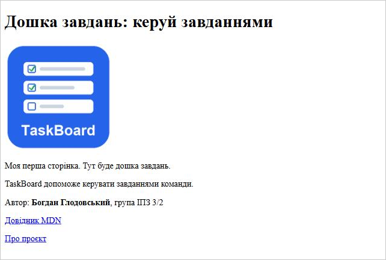

# TaskBoard


Дошка завдань: навчальний наскрізний проєкт з дисципліни
«Технології створення веб-застосунків».

## Автор

- Ім'я: Богдан Глодовський
- Група: ІПЗ 3/2

## Про проєкт

TaskBoard дозволяє створювати завдання, ставити їм статуси й
відстежувати виконання. Проєкт розвивається поетапно протягом курсу.

## Демо

[Відкрити сайт](https://vomprix52.github.io/taskboard/)

## Технології

| Шар | Технології |
|---|---|
| Frontend | HTML, CSS, JavaScript |
| Backend | Python, Flask *(буде додано)* |
| База даних | SQLAlchemy, PostgreSQL *(буде додано)* |
| Розгортання | Docker *(буде додано)* |

## План розвитку

- [x] Репозиторій і перша сторінка
- [ ] Адаптивна верстка (HTML + CSS)
- [ ] Інтерактивність (JavaScript)
- [ ] Серверна частина на Flask
- [ ] База даних та користувачі
- [ ] Docker
- [ ] REST API і тести
- [ ] Публікація онлайн

## Як запустити

1. Склонуй репозиторій:
   ```bash
   git clone https://github.com/vomprix52/taskboard.git
   ```
2. Відкрий папку у VS Code.
3. Запусти `index.html` через Live Server.

## Скріншот


